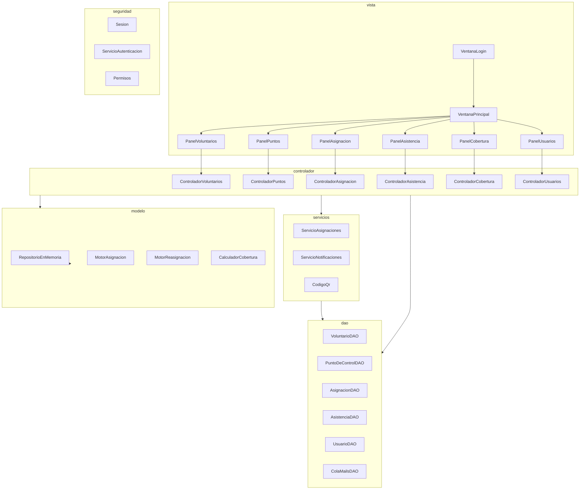
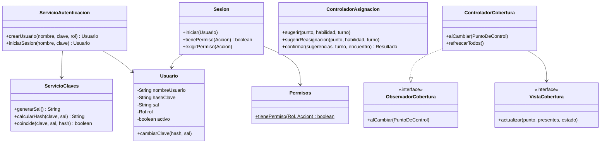

# Arquitectura, pilares de POO y patrones (tarjetas 6.5 y 6.7)

Resumen de **lo que realmente esta implementado**. El diagrama de clases del modelo base esta en
[modelo-clases.md](modelo-clases.md) y el esquema de la base en [esquema-bd.md](esquema-bd.md).

## Capas (MVC)

Cada capa solo habla con la inmediata inferior; la vista nunca toca la base. `Sistema` arma todas las piezas una sola vez
(una unica instancia compartida entre ventanas, como `Biblioteca` en UVA 6).

La **seguridad** atraviesa las capas: la vista consulta `Sesion.tienePermiso` para mostrar solo lo permitido y los
controladores vuelven a exigirlo con `Sesion.exigirPermiso`.

## Los cuatro pilares

| Pilar | Donde se ve |
|---|---|
| **Encapsulamiento** | `Persona`, `Voluntario`, `PuntoDeControl`, `Usuario`: atributos privados; los datos solo cambian por setters/metodos que validan y lanzan `DatosInvalidosException`. Las colecciones se devuelven como vistas no modificables. |
| **Herencia** | `Persona` (abstracta) -> `Voluntario` (abstracta) -> `VoluntarioMedico` / `VoluntarioSeguridad`; `Persona` -> `Coordinador`. |
| **Polimorfismo** | `Persona.getRol()` (cada subclase responde distinto); `EstrategiaAsignacion`, `NotificadorMail`, los `*DAO` y `VistaCobertura` se usan por su interfaz sin saber la clase concreta. |
| **Abstraccion** | Clases abstractas (`Persona`, `Voluntario`) e interfaces que ocultan el detalle: el modelo no sabe que hay SQLite, SMTP ni Swing. |

## Los cuatro patrones

| Patron | Interfaz / participantes | Para que |
|---|---|---|
| **Strategy** | `EstrategiaAsignacion` -> `EstrategiaPorHabilidadYDisponibilidad`; la usan `MotorAsignacion` y `MotorReasignacion`. | Cambiar el criterio de asignacion sin tocar los motores. F1 y F6 comparten la misma estrategia. |
| **Observer** | `ObservadorCobertura` (interfaz). Sujetos: `RepositorioEnMemoria` (cambio de asignaciones) y `ControladorAsistencia` (check-in/out). Observador: `ControladorCobertura`, que a su vez avisa a `VistaCobertura` (`PanelCobertura`). | El panel de cobertura se actualiza solo. Probado en `PanelesTest`. |
| **Adapter** | `NotificadorMail` <- `NotificadorMailSmtp` (Jakarta/Angus Mail) y `NotificadorMailConsola` (simulado). | El sistema no depende del proveedor de mail y se prueba sin red. |
| **DAO** | `VoluntarioDAO`, `PuntoDeControlDAO`, `AsignacionDAO`, `AsistenciaDAO`, `UsuarioDAO`, `ColaMailsDAO` y sus clases `...DAOSQLite`. | El modelo no conoce la base. |

## Clases agregadas desde el modelo base

## Observaciones honestas sobre el diseno

- `Coordinador` es una `Persona` del modelo, pero **no** se usa para iniciar sesion: el acceso al sistema se modela aparte con `Usuario` + `Rol`.
- La **reasignacion** no es una segunda interfaz Strategy: `EstrategiaReasignacion` usa por dentro la estrategia de asignacion base y agrega la regla de zonas cercanas con sobrante.
- Los datos viven en memoria (`HashMap`/`ArrayList`) y se guardan en SQLite en cada operacion; si la base falla, los controladores deshacen el cambio en memoria.
