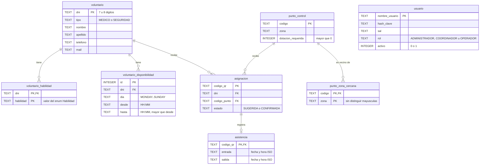

# Esquema de la base de datos (fase 2)

Base local SQLite en el archivo `voluntariado.db`. Al iniciar, la app ejecuta `src/main/resources/db/schema.sql`: crea las tablas que falten y no toca las que ya existen.

## Decisiones

| Tema | Decision | Por que |
|---|---|---|
| Herencia `Voluntario` | Una sola tabla `voluntario` con columna `tipo` | `VoluntarioMedico` y `VoluntarioSeguridad` no tienen atributos propios. Una tabla por subclase solo agregaria JOINs. Si en el futuro una subclase suma campos, se agrega una tabla hija con el mismo DNI como PK. |
| Habilidades, disponibilidades, zonas cercanas | Tablas hijas con `ON DELETE CASCADE` | Son listas dentro del objeto: si se borra el voluntario o el punto, no tienen sentido solas. |
| Asignaciones | FK con `ON DELETE RESTRICT` | No se puede borrar un voluntario o un punto con asignaciones: se perderia la historia y los QR enviados. |
| Una sola asignacion confirmada por voluntario | Indice unico parcial `WHERE estado = 'CONFIRMADA'` | Es la misma regla que valida `RepositorioEnMemoria`, pero ahora tambien la garantiza la base. Las sugeridas si pueden repetirse. |
| Codigo QR | Es la PK de `asignacion` | Ya es unico (UUID) y es lo que el voluntario presenta en el check-in: buscar por QR es la consulta principal. |
| Enums de Java | Texto + `CHECK` con los valores validos | Se lee facil en la base y no se rompe si cambia el orden del enum (guardar el `ordinal()` si se romperia). |
| Fechas y horas | Texto ISO-8601 (`08:00`, `2026-10-26T08:00`) | SQLite no tiene tipo fecha; en ISO el orden alfabetico coincide con el cronologico, asi funcionan los `CHECK` y los `ORDER BY`. |
| Roles | Columna `rol` con `CHECK`, sin tabla aparte | Los roles son fijos (enum `Rol`) y los permisos viven en codigo (`Permisos`). Una tabla de roles no agregaria informacion. |
| Contrasenas | Solo hash + sal | Nunca se guarda la contrasena en texto plano (Ley 25.326). Lo implementa la tarjeta 3.2. |
| Claves foraneas | `PRAGMA foreign_keys = ON` en cada conexion | SQLite las trae apagadas por defecto; sin esto las FK no se controlan. |

## Clases del paquete `dao`

- `ConexionBD`: abre conexiones y crea el esquema.
- `VoluntarioDAO`, `PuntoDeControlDAO`, `AsignacionDAO`: interfaces (patron DAO). Sus implementaciones `...SQLite` son las unicas clases que conocen SQL.
- `CargaInicial`: al abrir la app pasa la base al `RepositorioEnMemoria`. Solo las asignaciones confirmadas entran al repositorio.
- `DatosDePrueba`: 5 puntos y 30 voluntarios ficticios; se cargan solo si la base esta vacia.
- `PersistenciaException`: envuelve los errores de SQL para que las otras capas no dependan de JDBC.

Las tablas `asistencia` y `usuario` ya estan creadas, pero sus DAO son de otras tarjetas (3.15 y 3.1).
