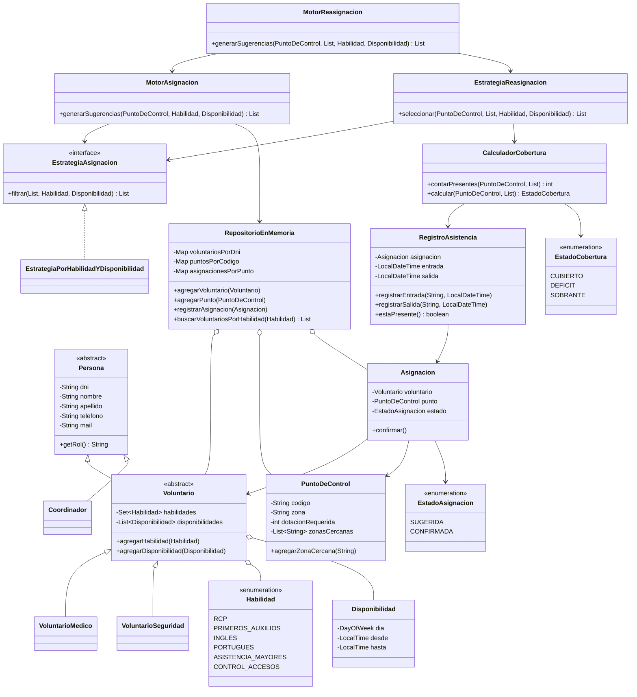

# Diagrama de clases del modelo (fase 1)

El codigo identifica un punto de control aunque haya varios en una misma zona. El DNI identifica a cada persona. El repositorio guarda asignaciones confirmadas por punto; las sugeridas todavia no forman parte de la lista de asignados.

